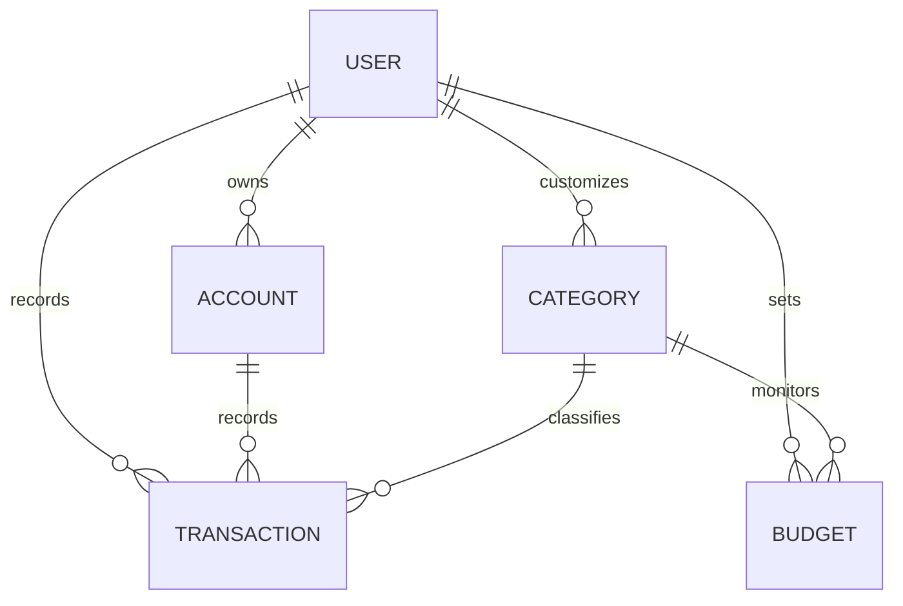

# Domain Context: Personal Finance Platform

This document captures the canonical ubiquitous language and domain model for the **finance** project. All code symbols, API interfaces, tests, and documentation must adhere to this vocabulary.

---

## 1. Ubiquitous Language

### Account (Wallet)
An individual container of monetary value owned by the user.
- **Cash**: Physical currency on hand.
- **Bank Account**: Checking or savings account held at a financial institution.
- **Credit Card**: Revolving line of credit with an established credit limit and billing statement cycle. Expenditures increase credit card balance (liability), and bill payments transfer funds from a Cash/Bank Account to the Credit Card.

### Transaction
An immutable record of monetary movement occurring at a specific point in time.
- **Expense**: Outflow of money from an Account assigned to an Expense Category.
- **Income**: Inflow of money into an Account assigned to an Income Category.
- **Transfer**: Reallocation of funds from a Source Account to a Destination Account. Does not change overall net worth or affect expense budgets.

### Category
A functional classification system for organizing transactions.
- Categories are divided into `Income` categories (e.g., Salary, Investments) and `Expense` categories (e.g., Food & Dining, Housing, Transportation, Utilities).
- Each category possesses an icon identifier and color for fast visual recognition on mobile viewports.

### Budget
A monthly monetary limit assigned to one or more expense categories.
- Tracks accumulated spend within a monthly billing period against the target limit.
- Emits threshold indicators (`On Track`, `Warning`, `Exceeded`).

### Currency
The monetary measurement unit. Default is **VND** (formatted according to Vietnamese locale: `100.000 ₫`), with architectural support for future multi-currency configuration.

### Quick Entry
An ergonomic, mobile-first user interaction flow designed to record an expense or income transaction in under 5 seconds using large numpad controls and one-tap category selection.

---

## 2. Core Entities & Schema Details

### Key Entity Attributes & Rules

- **Account**:
  - `id`: UUID (Primary Key)
  - `user_id`: String (Clerk User ID)
  - `name`: String
  - `type`: Enum (`CASH`, `BANK`, `CREDIT_CARD`)
  - `balance`: Numeric (Snapshot balance, updated with row-level locks)
  - `currency`: String (Default: `VND`)
  - `credit_limit`: Numeric (Only for `CREDIT_CARD`)
  - `statement_day`: Integer 1–31 (Only for `CREDIT_CARD`)
  - `due_day`: Integer 1–31 (Only for `CREDIT_CARD`)

- **Transaction**:
  - `id`: UUID (Primary Key)
  - `user_id`: String (Clerk User ID)
  - `type`: Enum (`EXPENSE`, `INCOME`, `TRANSFER`)
  - `amount`: Numeric (Strict positive value)
  - `account_id`: UUID (Source account for expense/income/transfer)
  - `destination_account_id`: UUID (Nullable, populated only when `type = 'TRANSFER'`)
  - `category_id`: UUID (Nullable for transfers; required for expense/income)
  - `transaction_date`: Timestamptz
  - `note`: Text (Optional)

- **Budget**:
  - `id`: UUID (Primary Key)
  - `user_id`: String (Clerk User ID)
  - `category_id`: UUID (Foreign Key to Category, Nullable for Overall Monthly Budget)
  - `amount`: Numeric (Monthly limit in VND)
  - `month`: Integer (1–12)
  - `year`: Integer
  - `is_rollover`: Boolean (Default: false)

- **Calculations & Invariants**:
  - **Net Worth**: `SUM(balance of CASH & BANK accounts) - SUM(balance of CREDIT_CARD accounts)`
  - **Transfer Invariant**: A transfer from Account A to Account B decrements A by `amount` and increments B by `amount`. Total net worth is unchanged.
  - **Budget Exclusion**: Transfers are never counted toward category expense budgets.
  - **Budget Health Status**: Green (<75%), Amber (75–99%), Rose (>=100%). Over-budget transactions emit soft warnings and are never blocked.
