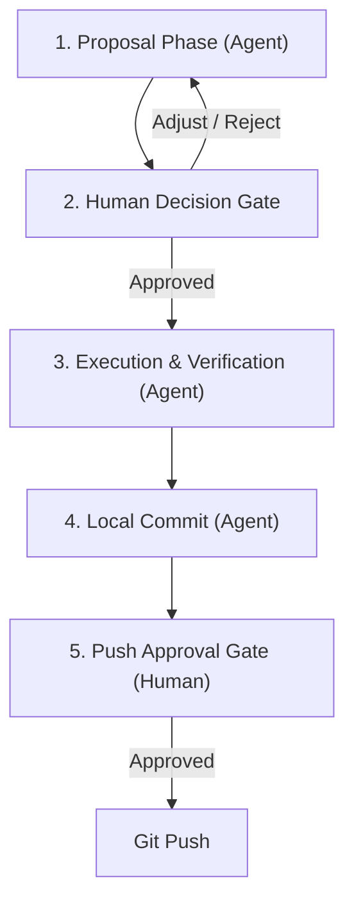

# Git Workflow & Conventions

> This document defines the mandatory Git workflow, branch naming standards, commit message format, and human-in-the-loop approval gates for all contributors and AI Agents in the **finance** repository.

---

## 1. Agent Workflow & Human-in-the-Loop Gate

To ensure complete maintainer oversight, **AI Agents must never autonomously modify repository state, create branches, or make commits without prior confirmation**.

### The 4-Step Lifecycle



#### Step 1: Proposal Phase (Agent)
Before executing any write commands, the agent must present a structured proposal to the maintainer:
1. **Target Branch Name**: Formatted according to Section 2.
2. **Planned Scope of Work**: Specific files to create, modify, or delete.
3. **Draft Commit Message**: Formatted according to Section 3.

#### Step 2: Human Decision Gate (MANDATORY STOP)
- The agent **MUST STOP** and wait for the maintainer's explicit approval (`Proceed`, `đồng ý`, `thực thi`, or specific feedback).
- **Prohibition**: The agent must never run `git checkout -b`, touch code, or stage files during this gate.

#### Step 3: Execution & Verification
Once approved:
1. Create and switch to the proposed branch: `git checkout -b <branch-name>`.
2. Implement the changes.
3. Run verification (tests, linting, builds).

#### Step 4: Local Commit
- Stage modified files: `git add <files>`.
- Commit locally using the approved commit message: `git commit -m "..."`.

#### Step 5: Push Approval Gate
- The agent **must not** run `git push` autonomously.
- The agent informs the maintainer that the local commit is complete and asks for permission before running `git push origin <branch-name>`.

---

## 2. Branch Naming Conventions

### Format
```text
<type>/<issue-number>-<short-slug>
```
If the work is not tied to a specific issue:
```text
<type>/<short-slug>
```

### Rules
1. **Lowercase only**: All characters must be lowercase.
2. **Kebab-case**: Use hyphens (`-`) to separate words.
3. **No hash symbol (`#`)**: Do not include `#` in the branch name to ensure terminal shell compatibility (e.g. use `feat/3-relational-schema`, **not** `feat/#3-relational-schema`).
4. **Valid Types**:
   - `feat/`: New feature or significant enhancement.
   - `fix/`: Bug fix.
   - `refactor/`: Code restructuring without changing external behavior.
   - `docs/`: Documentation additions or revisions.
   - `test/`: Adding or updating test suites.
   - `chore/`: Tooling, dependency updates, configuration adjustments.

### Examples
- `feat/3-relational-schema`
- `feat/4-mobile-quick-entry`
- `fix/12-credit-card-statement-calc`
- `chore/6-setup-monorepo-structure`
- `docs/git-workflow-rules`

---

## 3. Commit Message Conventions (Conventional Commits)

Commit messages must follow the **Conventional Commits** specification in **English**.

### Format
```text
<type>(<scope>): <summary> (#<issue-number>)

[optional detailed body explaining motivation, rationale, and changes]

[optional footer: Refs #<issue> or Closes #<issue>]
```

### Types
- `feat`: A new user-facing feature or capability.
- `fix`: A bug fix.
- `docs`: Documentation-only changes.
- `style`: Formatting, whitespace, semi-colons (no production code change).
- `refactor`: Code refactoring that neither fixes a bug nor adds a feature.
- `perf`: Code change that improves execution or query performance.
- `test`: Adding missing tests or correcting existing tests.
- `chore`: Build process, package dependencies, repository configuration.

### Scopes (Examples)
- `account`, `transaction`, `budget`, `category`, `auth`, `ui`, `api`, `deps`, `docs`.

### Subject Line Rules
1. **Imperative mood**: Use "add", "fix", "update", not "added", "fixing", "updates".
2. **Lowercase first letter**: E.g. `feat(account): add snapshot balance...`.
3. **No trailing period**: Do not end the subject with `.`.
4. **Issue reference**: Include `(#<issue-number>)` at the end of the subject or in the footer.

### Examples
```text
feat(account): add snapshot balance with row-level locking (#3)

Implements atomic balance updates inside database transactions using
SELECT ... FOR UPDATE to eliminate concurrency race conditions.

Refs #3
```
```text
fix(transaction): correct transfer balance deduction for source wallet (#15)
```
```text
docs(git): define branch naming and commit conventions
```

---

## 4. Forbidden Operations (Agent Guardrails)

The following Git commands are **strictly prohibited** for AI Agents unless explicitly commanded by the user with exact instructions:
- `git push --force` or `git push -f`
- `git reset --hard`
- `git clean -fd`
- Committing directly to `main` without maintainer approval
- Creating branches with uppercase letters, spaces, or `#` characters
