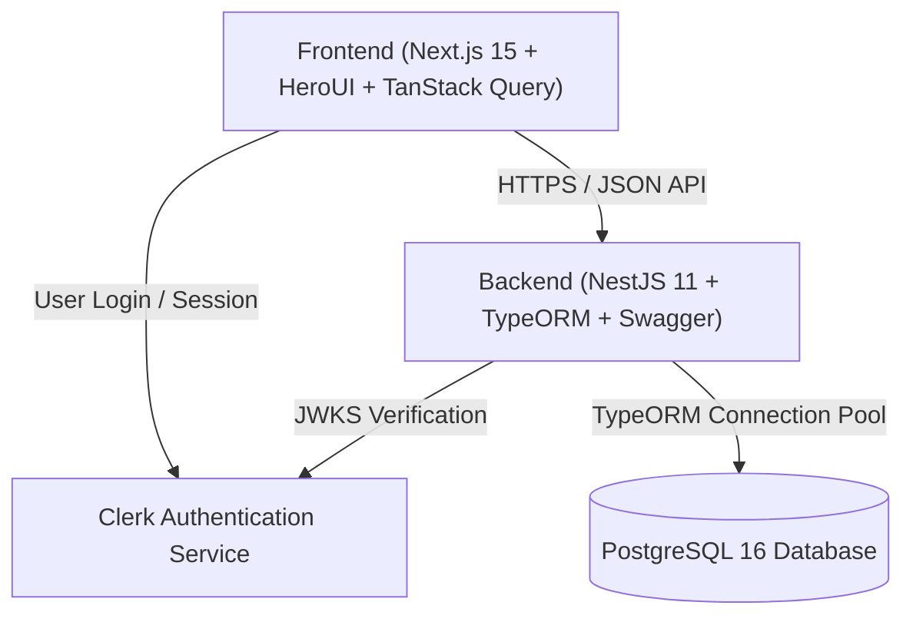

# Feature Spec: Personal Finance Mobile-First Platform (MVP)

> This document is the canonical specification synthesizing all architectural decisions, domain models, user interface workflows, and technical contracts established during the Wayfinder planning phase.

---

## 1. Overview & Context

- **Objective**: Deliver a responsive, mobile-first personal finance web application enabling users to log expenses in under 3 seconds, manage accounts and credit cards, track monthly category budgets, and monitor recurring bills.
- **Target Audience**: Individual users seeking frictionless financial awareness on mobile devices.
- **Value Proposition**: High-speed, single-thumb data entry with zero arithmetic rounding drift, real-time snapshot balances, offline reliability, and complete independence between frontend and backend deployments.

---

## 2. Scope & Boundaries

### In-Scope (MVP)
- **Account & Wallet Management**: Cash, Bank accounts, and Credit Cards (credit limit, statement day, due day, Net Worth tracking).
- **Transaction Engine**: Income, Expense, and internal Transfers (unified single-record, excluded from budget tracking).
- **Mobile-First Quick Entry**: 2-tap category-first flow with standard Vietnamese banknote presets (`+20k`, `+50k`, `+100k`, `+500k`) and a custom numpad with `000`.
- **Budget Tracking**: Calendar-month category budgets with tri-color indicators (Green <75%, Amber 75–99%, Rose $\ge 100\%$) and non-blocking soft warnings.
- **Recurring Bills**: Due-date actionable approval cards with 1-tap confirmation and variable bill amount support.
- **Offline Reliability**: Local queue in IndexedDB with optimistic UI and UUID v4 (`client_tx_id`) idempotency deduplication.
- **Security**: Clerk Authentication with secure session verification on NestJS API routes.

### Out-of-Scope (Deferred to Post-MVP)
- Automated Open Banking sync via private bank APIs.
- Bank statement file import / PDF parsing (deferred in Ticket #8).
- Multi-user joint accounts and family sharing.
- Investment portfolios (crypto, stocks).

---

## 3. Architecture & Tech Stack

| Component | Technology | Rationale | Reference ADR |
|---|---|---|---|
| **Frontend** | Next.js 15, Tailwind CSS v4, HeroUI, TanStack Query v5, Zustand, Lucide | Instant mobile UX, modern component library, offline optimistic caching | [ADR-0003](../adr/0003-mobile-first-ui-and-quick-entry-flow.md) |
| **Backend** | NestJS 11, TypeORM, Express Adapter, Swagger | Enterprise TypeScript architecture, seamless decorator data modeling | [ADR-0001](../adr/0001-nestjs-backend-and-clerk-auth.md), [ADR-0007](../adr/0007-typeorm-database-orm.md) |
| **Database** | PostgreSQL 16 (via Docker Compose) | ACID compliance, row-level locking for atomic transfers | [ADR-0002](../adr/0002-relational-schema-and-transaction-state-machine.md) |
| **Auth** | Clerk Auth | Turn-key auth UI, OAuth, Passkeys, zero password storage liability | [ADR-0001](../adr/0001-nestjs-backend-and-clerk-auth.md) |
| **Linter** | OXC (`oxlint`) | Ultra-fast Rust-based linting across both standalone projects | Root `.oxlintrc.json` |

---

## 4. Domain Data Model & Key Invariants

Refer to `CONTEXT.md` for full ubiquitous language definitions.

### Core Tables
1. **`accounts`**: `id`, `user_id`, `name`, `type` (`CASH` | `BANK` | `CREDIT_CARD`), `balance` (numeric snapshot), `currency` (VND), `credit_limit`, `statement_day`, `due_day`.
2. **`categories`**: `id`, `user_id`, `name`, `icon`, `color`, `type` (`EXPENSE` | `INCOME`).
3. **`transactions`**: `id`, `client_tx_id` (UUID unique), `user_id`, `type` (`EXPENSE` | `INCOME` | `TRANSFER`), `amount`, `account_id`, `destination_account_id`, `category_id`, `transaction_date`, `note`.
4. **`budgets`**: `id`, `user_id`, `category_id` (nullable for total monthly budget), `amount`, `month`, `year`, `is_rollover`.
5. **`recurring_transactions`**: `id`, `user_id`, `name`, `type`, `amount`, `is_variable_amount`, `account_id`, `category_id`, `frequency`, `due_day`, `next_due_date`, `is_active`.

### Critical Invariants
- **Net Worth**: $\text{Net Worth} = \sum \text{Balance}_{\text{Cash/Bank}} - \sum \text{Balance}_{\text{Credit Card}}$.
- **Snapshot Atomicity**: All balance modifications must be executed inside database transactions using `SELECT ... FOR UPDATE` row locks.
- **Transfer Neutrality**: Transfers do not alter net worth and are excluded from category budget tracking.

---

## 5. API Endpoints Overview (NestJS)

All routes protected via Clerk Auth Guard (extracting `user_id` from Bearer token):

- **Accounts**:
  - `GET /api/accounts` - List all accounts with live balances and credit limits.
  - `POST /api/accounts` - Create new wallet/account.
  - `PATCH /api/accounts/:id` - Update account details.
- **Transactions**:
  - `GET /api/transactions` - Filtered list (by date range, account, category).
  - `POST /api/transactions` - Log expense/income/transfer (idempotent via `client_tx_id`).
  - `DELETE /api/transactions/:id` - Revert transaction and atomically restore balances.
- **Budgets**:
  - `GET /api/budgets/summary?month=M&year=Y` - Monthly budget progress bars and status.
  - `PUT /api/budgets` - Set/update category budget limit.
- **Recurring Transactions**:
  - `GET /api/recurring` - List recurring schedules.
  - `POST /api/recurring/:id/confirm` - Post scheduled transaction with optional adjusted amount.

---

## 6. Implementation Roadmap (Post-Planning)

1. **Sprint 1: Core Backend Entities & Database Migrations**:
   - Define TypeORM entity classes in `backend/src/entities/`.
   - Implement `AccountsModule` and `TransactionsModule` with atomic row-locking balance service.
2. **Sprint 2: Clerk Auth Integration & API Guards**:
   - Configure Clerk middleware in `backend/` and Clerk Provider in `frontend/`.
3. **Sprint 3: Mobile Dashboard & Quick Entry Implementation**:
   - Implement hero Net Worth card, account slider, and 2-tap Quick Entry modal using HeroUI in `frontend/`.
4. **Sprint 4: Budget Management & Recurring Approvals**:
   - Implement category budget progress bars with tri-color warnings and recurring bill approval cards.
5. **Sprint 5: Offline Sync & PWA Packaging**:
   - Configure IndexedDB offline mutation queue and Service Worker manifest.
